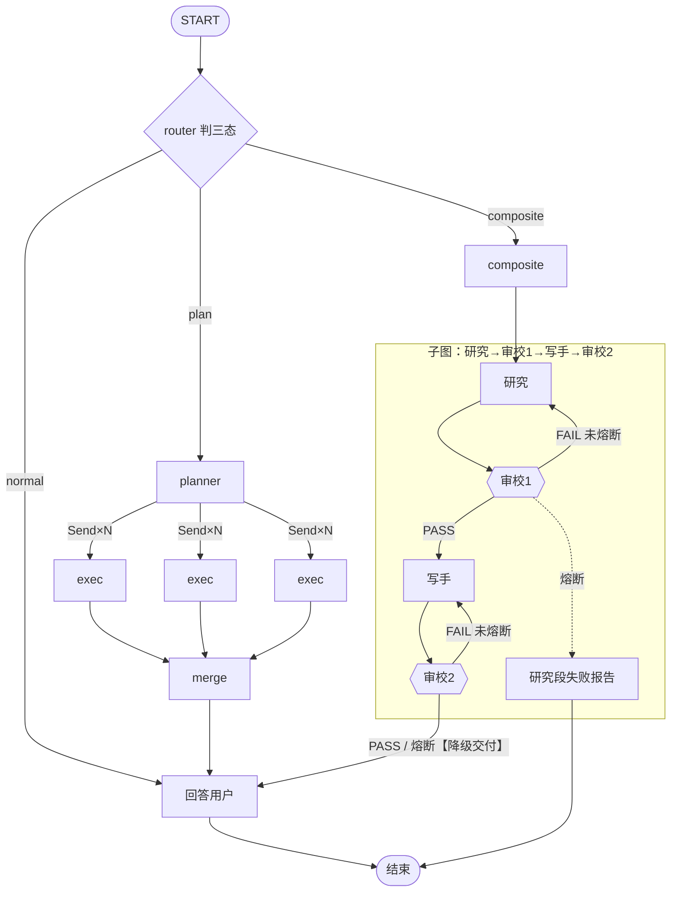

## mermaid 绘图规则速查（flowchart）

### 代码块与方向

- 代码围栏语言写 ```` ```mermaid ````——`flowchart TD` 是图内容的**第一行**，不是围栏标记（写成 ```` ```flowchart ```` 预览不渲染）
- `flowchart TD` 自上而下 / `flowchart LR` 从左到右
- 缩进随意（建议 4 空格），行内 `#` 后是注释

### 节点形状（LangGraph 语境对照）

| 写法 | 形状 | 画什么 |
|---|---|---|
| `A[文本]` | 矩形 | 普通节点（LLM 调用/处理步骤） |
| `A([文本])` | 圆角胶囊 | START / END |
| `A{文本}` | 菱形 | 判定/路由（条件边函数） |
| `A{{文本}}` | 六边形 | 审校/门类判定 |
| `A[/文本/]` | 平行四边形 | 输入输出 |
| `A[(文本)]` | 圆柱 | 存储（checkpointer/Store） |
| `A:::类名` | 挂样式 | 配合 classDef（见下） |

**id 与显示文本分离**：`ROUTER{router 判三态}` 里 `ROUTER` 是 id（必须英文、无空格），`{...}` 里是显示文本（可中文可特殊字符）。后面所有边都引用 id。

### 连线

| 写法 | 含义 | LangGraph 对照 |
|---|---|---|
| `A --> B` | 实线箭头 | addEdge |
| `A -->|label| B` | 带标签边 | addConditionalEdges 的分支 |
| `A -.-> B` | 虚线 | interrupt / 熔断等异常路径 |
| `A -.->|label| B` | 虚线带标签 | 同上，带说明 |
| `A ==> B` | 粗线 | 强调主干路 |
| `A --> B & C & D` | 一对多 | Send fan-out |
| `B & C & D --> E` | 多对一 | 并行聚合（reduce） |
| `W --> V2`（指回已有节点） | 回边 | 修订循环（无特殊语法，指回去就是环） |

### 子图

```text
subgraph id [标题]
    节点与边...
end
```

- `subgraph` 后是 id（无空格），`[ ]` 里是标题（随意）
- **想让节点留在子图外，就别让 subgraph 块内的语句提到它**——归属语义随 mermaid 版本有差异（首提归属/块内认领都存在过），块外裸声明不一定兜得住；子图内的出口指向子图内节点（如 FAIL），真正的出图边（`FAIL --> END`）写在 subgraph 块外面（块外语句引用块内节点是合法的，跨边界边照画）
- 子图可嵌套；子图 id 可直接当连线目标（`A --> composite` = 连到子图整体）
- 父图壳节点（`COMPOSITE[composite]`）连子图首节点（`COMPOSITE --> RESEARCH`）= 「编译好的图当节点挂载」的画法

### 样式（区分门/异常路径）

```text
classDef gate stroke-dasharray: 5 5
class 确认门节点 gate
```

### 本图踩过的坑

1. 围栏写成 ```` ```flowchart ```` → 预览一片空白，语言标记必须是 `mermaid`
2. END 被 subgraph 块内的边提到（`FAIL --> END` 写在块里）→ 终点被吸进子图；裸声明兜不住（归属语义随版本漂移）。稳妥做法：块内不提 END，出图边写在块外
3. 壳节点和 subgraph 是两个东西，长得像不会自动连——要么补一根边，要么删壳直连
4. 边标签里 `|` 不能再出现；显示文本含括号等特殊字符要用引号包：`A["文本(x)"]`
5. VSCode 内置预览不渲染 mermaid，装 Markdown Preview Mermaid Support；GitHub 网页原生渲染可当裁判